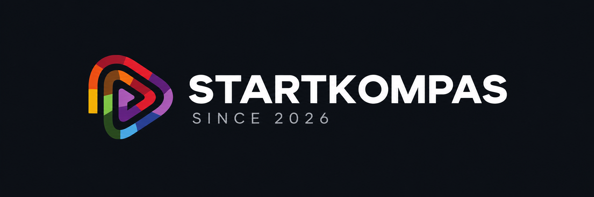
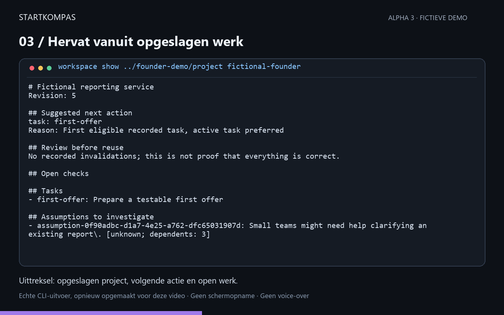

<p align="left">
  
</p>

# Startkompas — public alpha

Keep project decisions, unfinished work and the basis for your business drafts together. This early local Codex skill lets you save a draft, change a premise, see what needs review and resume later.

This is an experimental alpha. Independent user validation is still ahead. No measured time saving, business success or compliance outcome is promised. Download this repository using Code → Download ZIP, or clone https://github.com/davidvuy/startkompas-alpha. For feedback use https://github.com/davidvuy/startkompas-alpha/issues.

## Start here

[Download alpha 8 (ZIP)](https://github.com/davidvuy/startkompas-alpha/archive/refs/tags/v0.1.0-alpha.10.zip) · [Quickstart](docs/quickstart.md) · [Release notes](docs/alpha-changelog.md)

Extract the ZIP into a new folder. Open a terminal in that folder, install the locked dependencies and open the English menu:

```sh
npm ci --ignore-scripts --no-audit --no-fund
node start.mjs
```

The menu offers installation checks, a fictional demo, new projects, resuming, offer drafts and a report preview/save flow. It runs locally; it does not call AI or upload your project. All product prompts and new generated document labels are English. See the guide for prerequisites and the exact first-use steps.

## Local browser workspace

Choose an existing projects parent outside the app and run `npm run ui -- ../my-projects`. Open the private session link printed by the terminal. Create a project through a three-step wizard, reuse optional context in your first offer, and explicitly confirm saving. Select sections for a report, preview and save a new local Markdown file. Archive projects without deleting their files and restore them through Show archived projects. Revise it later with a reason; previous versions remain intact. The server binds only to your computer, uses per-session access checks and makes no AI calls. See [workspace setup and limits](docs/local-ui.md). Keep the terminal open while using it.

## Guided project work

Prepare an offer or interview guide, record assumptions and observations, connect decisions to their basis, and export a readable report without writing request JSON. [Product guide](docs/alpha-workspace.md) · [Browser workspace](docs/local-ui.md) · [Changes](docs/alpha-changelog.md).

~~~sh
node src/startkompas.mjs workspace show ../my-project my-project
node src/startkompas.mjs workspace draft ../my-project my-project offer
node examples/demo-founder-workflow.mjs ../founder-demo
~~~

The example uses fictional input and produces `workspace.md`, `report.md` and an export/restore check. Assumptions remain unknown; drafts are not approved business advice.

**Need help?** [Ask a question, report a bug or suggest an improvement](https://github.com/davidvuy/startkompas-alpha/issues/new/choose). [Join Discussions](https://github.com/davidvuy/startkompas-alpha/discussions) for general usage questions. Dutch and English are welcome. For sensitive vulnerabilities use [private security reporting](https://github.com/davidvuy/startkompas-alpha/security/advisories/new). Never put credentials or private dossiers in public issues. See [support and FAQ](docs/alpha-support.md).

[Watch the 40-second demo](assets/startkompas-demo.mp4) · [All five output previews](docs/alpha-demo.md#captured-founder-workflow)



The video and previews reformat actual CLI output. They are not screen recordings or customer results.

**See it work:** follow the [fictional offer walkthrough](docs/alpha-demo.md), then use the guided setup below. See the [four-week improvement roadmap](docs/alpha-roadmap.md) for our priorities and ways to contribute.

Run `node src/startkompas.mjs doctor`, then `node src/startkompas.mjs start` for guided setup without a JSON request. Use `overview <directory> <project-id> [nl|en]` for a readable summary and `compare <directory> <project-id> <older> <newer>` for saved changes. See [the alpha 2 guide](docs/alpha-improvements.md).

## Try the local helper

Prerequisites: Node.js and npm; the reproducible development pin is 26.7.0. The Quality matrix exercises the helper on Windows, Linux and macOS with Node 26.7.0 and 24.x; inspect the latest successful run for the version you download. This does not establish Codex host compatibility or qualify arbitrary Node versions. Codex access is needed for AI-assisted use, with your provider's own quotas and charges. The following deterministic demo does not call an AI service.

Extract the complete product package into a new directory. In that directory run:

~~~powershell
npm ci --ignore-scripts --no-audit --no-fund
npm test
node src/startkompas.mjs --help
node examples/demo-offer-change.mjs ../my-first-startkompas-demo
~~~

The demo target must not already exist. It uses fictional business text, saves an offer, revises one outcome, retains the original and checks export/restore. It prints its checks and the created output paths.

## Start your project

Keep your private project outside the application folder. Use the guided setup, review the proposed details and confirm explicitly:

~~~powershell
node src/startkompas.mjs doctor
node src/startkompas.mjs start
~~~

To resume, use your chosen directory and project ID:

~~~powershell
node src/startkompas.mjs overview ../my-private-project my-project en
~~~

Alternatively, for scripted setup, save this as a separate init.json file, adjusting the name:

~~~json
{"project_id":"my-project","name":"My business idea","first_task":{"id":"first-offer","title":"Draft my first offer"}}
~~~

~~~powershell
node src/startkompas.mjs project init ../my-private-project ../init.json
node src/startkompas.mjs project handoff ../my-private-project my-project
~~~

The project starts empty: it does not invent your budget, customers or demand. Use the command guide for intake, draft preparation and explicit saving. The first intake answer can now include its source in one proposed update. Keep the exact saved update request for retries.

For AI-assisted use, open the extracted application folder in Codex. The package contains .agents/skills/startkompas; invoke Startkompas and explicitly identify the separate private project directory. Original local Codex trials are recorded, but automatic discovery in every current desktop build is not guaranteed. The helper commands above remain directly executable.

## Give useful feedback

Use the Issues tab of this repository for non-sensitive feedback. Report the package revision, operating system, Node version, what you tried, what you expected and what happened. Small fictional reproductions are best. Tell us whether you could install, get a useful result and resume without help. There is no automatic usage telemetry in the helper.

Never attach private dossiers, customer data, credentials or full conversation logs to public issues. For sensitive reports use the Security tab and Report a vulnerability if available; otherwise do not submit details publicly. No response-time or support guarantee is offered for the alpha.

## Limits and data

Local dossiers do not make AI processing local: text supplied to Codex can be processed by its provider. Keep backups and inspect exports before sharing. Removing the application does not erase private projects, shared exports or provider records. Do not use draft business content as qualified legal, tax or security advice. Claude, browser/mobile routes and managed cloud services are not offered by this alpha.

The alpha1 baseline passed 167 source and clean-install tests. Alpha2 added onboarding and comparison. Alpha3 adds guided work, selective report export and recovery checks. See the public Quality and Secret scan workflows for current results. These are technical checks, not real-user validation.

## Contribute or fork

See [contribution guidance](CONTRIBUTING.md), the [four-week roadmap](docs/alpha-roadmap.md) and [the 50-item progress register](docs/alpha-progress.md). Focused fixes, clearer examples and fictional reproductions are useful contributions. If the project helps you, a star makes it easier to find again. No popularity or business outcome is promised.

### Find and resume your work

The local workspace includes fictional practice projects, optional tab-local form recovery, project search/sorting, saved-document inspection, original-record and dependency navigation, and read-only history comparisons. Offer conflicts can be compared before explicitly keeping your text against a newer revision; saving still needs a fresh preview and confirmation. Report a problem prepares a minimal technical report for review before copying. See [local workspace](docs/local-ui.md) for limits and data handling.

Alpha 8 adds explicit on-disk setup/offer recovery copies, saved-draft text search, task focus/progress choices, historical offer reuse as a new explained version, recent-work shortcuts, offer field guidance and contextual error actions. Disk copies contain plaintext and remain until explicitly forgotten; this is manual recovery, not automatic saving.
