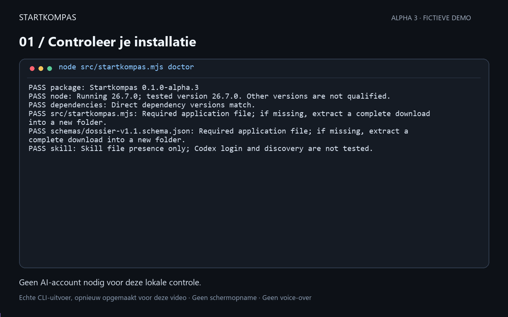
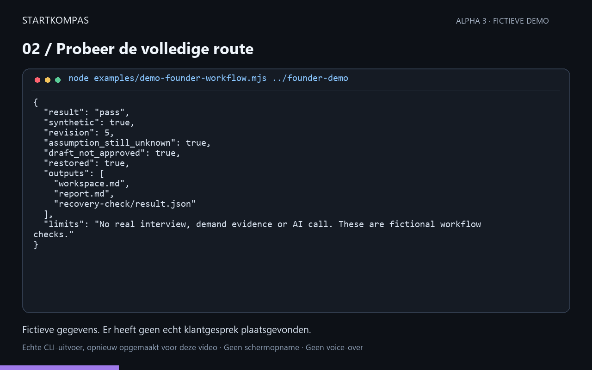
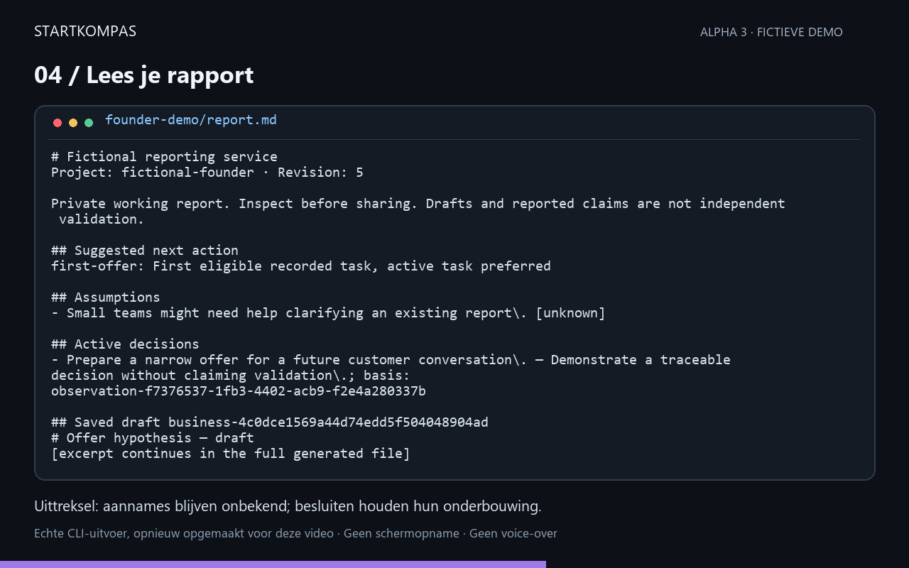
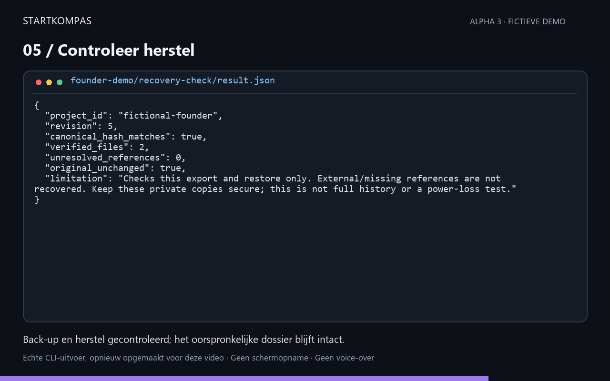

# A first result without an AI account

This walkthrough uses fictional business text. It needs Node 26.7.0 and npm, but no API key or AI call.

From the extracted application directory:

```sh
npm ci --ignore-scripts --no-audit --no-fund
node src/startkompas.mjs doctor
node examples/demo-offer-change.mjs ../startkompas-demo-1
```

Choose a destination that does not exist. Expected result: JSON containing `"result": "pass"`, `"synthetic": true`, `"original_preserved": true` and seven checks.

Open these files in the new demo directory:

| File | What to look for |
| --- | --- |
| offer-v1.md | The original fictional offer |
| offer-v2.md | The narrower proposed outcome |
| result.json | Save, retry, revision and restore checks |

The second offer changes the outcome to “Eén bestaand rapport verduidelijken”. The earlier offer is preserved. Unknowns remain unknown and the task is not falsely marked complete. The exported dossier is restored and read back to check that the saved document survived.

This demonstrates storage and revision behavior, not independent customer validation.

## Start your own empty project

```sh
node src/startkompas.mjs start
```

The wizard asks for a project name, ID, a new private directory and an optional first task. Review the details and explicitly confirm. Keep the directory outside the application.

To resume, substitute your own directory and project ID:

```sh
node src/startkompas.mjs overview ../my-private-project my-project en
```

Product summaries use English. Legacy `nl` request codes remain readable for compatibility. For AI-assisted drafting, follow the README's Codex instructions. For help, see [support](alpha-support.md).

## Captured founder workflow

[Watch the 40-second video](../assets/startkompas-demo.mp4). The five panels below reproduce actual captured output from `doctor` and `demo-founder-workflow`. They are reformatted output, not desktop screenshots. The example is fictional, makes no AI calls and does not validate customer demand. Long outputs are explicitly excerpted.









